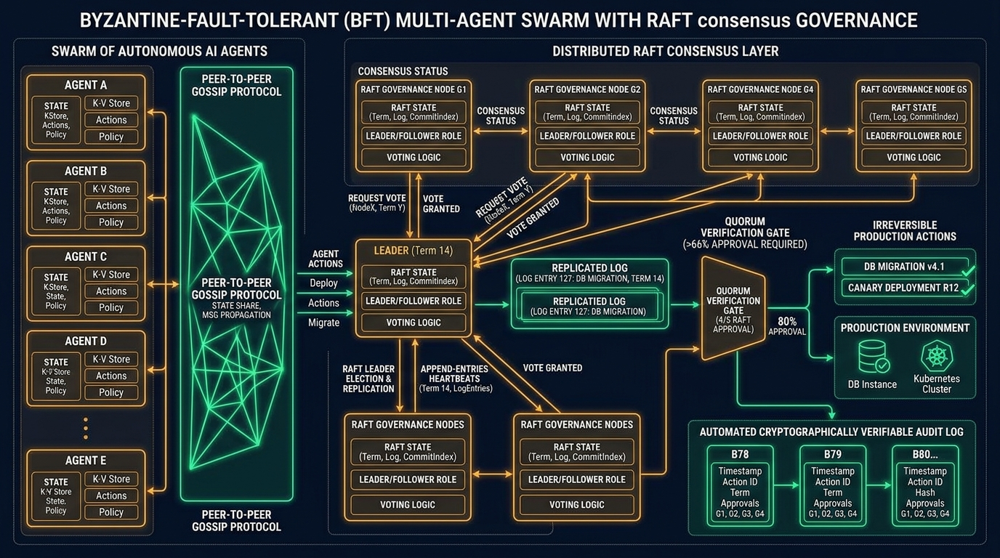

[](https://pradeeptalari.me/projects/)
[](https://pradeeptalari.me/tools/repo-learning/)

# Multi-Agent Swarm RAFT Consensus Studio

[](https://github.com/Pradeeptalari14/tp-agent-swarm-consensus/actions)
[](LICENSE)
[](https://talaripradeep.info)

Production implementation of **Byzantine-Resilient Multi-Agent Swarm Governance** with distributed RAFT consensus and verifiable quorum execution gates.



## Key Technical Highlights
- **Decentralized RAFT Consensus:** Enables autonomous agent clusters to elect quorum leaders and replicate action logs without central orchestrators.
- **Irreversible Action Quorum Gate:** Enforces >66% cryptographic peer approval before executing database migrations or cluster rollbacks.
- **Zero Single-Point-of-Failure:** Recovers automatically from node dropouts and splits within milliseconds.
- **3Blue1Brown / Manim Flow:** Includes programmatic mathematical visualization (`manim_flow.py`) of RAFT consensus terms.

## Quickstart
```bash
git clone https://github.com/Pradeeptalari14/tp-agent-swarm-consensus.git
cd tp-agent-swarm-consensus
bash scripts/validate.sh
```

---
*Synchronized with [Multi-Agent Swarm RAFT Consensus Studio Studio](https://pradeeptalari.me/tools/agent-swarm-consensus/) & [Repository Learning DAG](https://pradeeptalari.me/tools/repo-learning/) — [Talari Pradeep Portfolio](https://pradeeptalari.me)*
